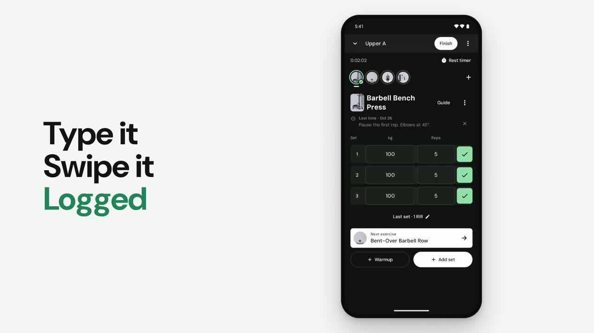

# Open Factor

**A free, open-source workout tracker for Android.**

Open Factor helps you log your gym sessions without the clutter. Pick an exercise, watch how it's done, write down your weight and reps, and save your workout. That's it. No account, no subscription, no ads.

> **Open Factor is in beta.** It works well for everyday logging, but expect a few rough edges. Your [feedback and bug reports](https://github.com/aarsh21/open-factor/issues) help make it better.

[**⬇️ Download the latest version**](https://github.com/aarsh21/open-factor/releases/latest/download/open-factor.apk) · [What's new in 0.9.1](docs/open-factor/releases/v0.9.1.md)

**▶ [Watch the 49-second intro](docs/media/open-factor-intro.mp4)**

## What you can do with it

- **Log your workouts quickly.** Type your weight and reps on a built-in number pad made for the gym, then swipe a set to mark it done (or swipe the other way to delete it).
- **Learn every exercise.** Search more than 1,300 exercises. Many come with demonstration videos from several camera angles, photos, step-by-step instructions, and a body map showing which muscles they work.
- **Follow a plan.** Start from a ready-made weekly routine (Upper/Lower, Push/Pull/Legs, Bro split or Full body), build your own templates, or set up a longer program.
- **Swap exercises on the fly.** Machine taken? Pick a similar exercise for the same muscles, using the equipment your gym actually has.
- **Keep notes.** Leave yourself reminders on an exercise, like seat height or grip, and see what you wrote last time.
- **Rest timer.** A timer starts automatically after each set, with optional notifications.
- **See your progress.** Workout history, a weekly calendar, charts of which muscles you've trained, body weight trends, step counts and progress photos.
- **Connect to Health Connect.** Bring in your weight, body fat and daily steps from other health apps. Open Factor only reads this data and never changes it.
- **Make it yours.** Light or dark mode, five color themes, kilograms or pounds.
- **Your data stays on your phone.** Everything works offline, with no sign-up. You can save a backup file and restore it on any phone.

> **Good to know:** Exercise videos stream over the internet the first time you watch them, and recently watched videos are kept for a while afterwards. Everything else (logging, photos, instructions and muscle maps) works without a connection.

## How to install

Open Factor isn't on the Google Play Store yet, so you install it directly:

1. On your Android phone, tap [**Download the latest version**](https://github.com/aarsh21/open-factor/releases/latest/download/open-factor.apk).
2. Open the downloaded file (`open-factor.apk`).
3. If Android asks, allow your browser or file app to **install unknown apps**. This is normal for apps from outside the Play Store.
4. Tap **Install**, then open Open Factor and follow the short setup.

You'll need **Android 8.0 or newer**.

### Updating

Install the new version over the old one the same way, and your workouts are kept. To be safe, save a backup first under **Settings → Export Backup** and keep the file somewhere outside the app.

## Need help or found a bug?

[Open an issue](https://github.com/aarsh21/open-factor/issues) and tell us what happened. It helps to include your phone model, your Android version and the Open Factor version (shown in Settings). Please don't attach your backup file or progress photos, since issues are public.

## What's next

- **Calorie tracking**, so food and training live in one place.
- **A smoother app overall:** polishing the everyday experience based on your feedback.
- **More platforms:** iOS, wearables and other integrations.

## Support Open Factor

Open Factor is free and will stay free, with no ads. If it helps your training and you'd like to support its development, you can donate directly by UPI:

**UPI ID: `padiaaarsh@okicici`**

Scan the code with any UPI app (Google Pay, PhonePe, Paytm, BHIM) or enter the UPI ID. Every contribution is appreciated, and starring the project on GitHub or sharing it with a gym friend helps too.

## Thank you

- **[Jeff Nippard](https://www.youtube.com/@JeffNippard)**: a huge thank you for the exercise demonstration videos. They make it much easier to learn each movement with good form.
- **Everkinetic** for exercise illustrations, and the **DM Sans** font authors.

See [CREDITS.md](CREDITS.md) for full details.

## For developers

Open Factor is a native Android app written in Kotlin with Jetpack Compose. Build instructions, media packaging and release details are in [docs/open-factor/BUILDING.md](docs/open-factor/BUILDING.md). If you'd like to contribute, see [CONTRIBUTING.md](CONTRIBUTING.md).

## License

The app's code is free and open source under the [MIT License](LICENSE). Exercise videos, photos and other media are not covered by that license. They belong to their original owners.
