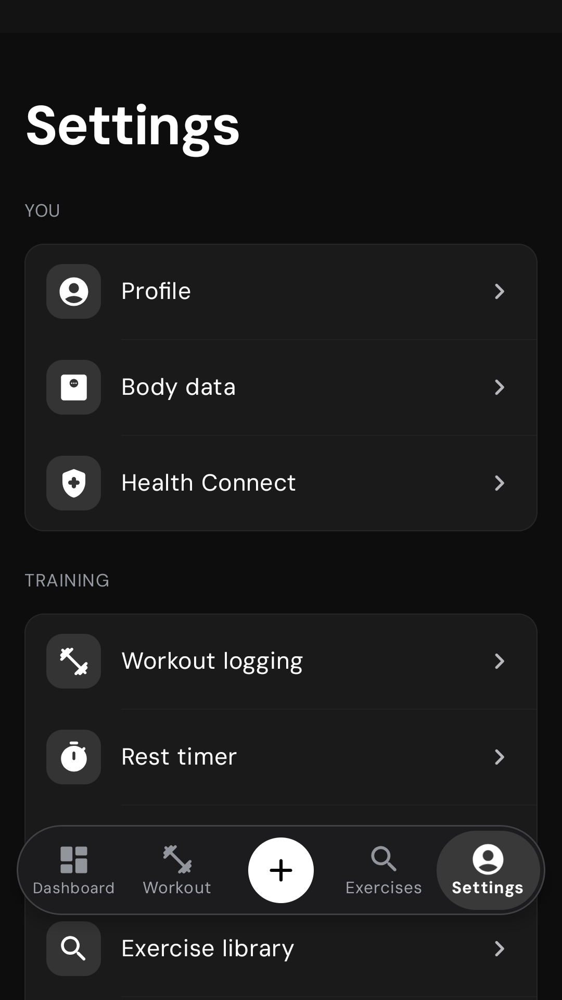
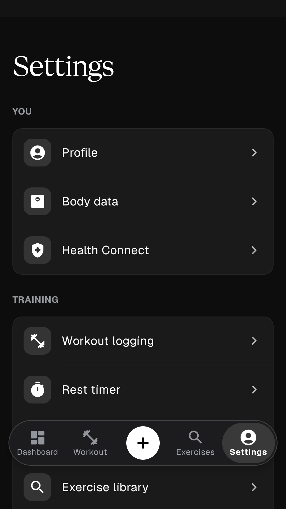
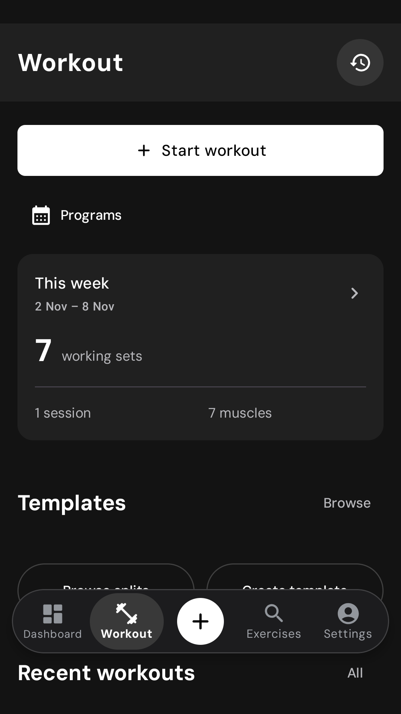
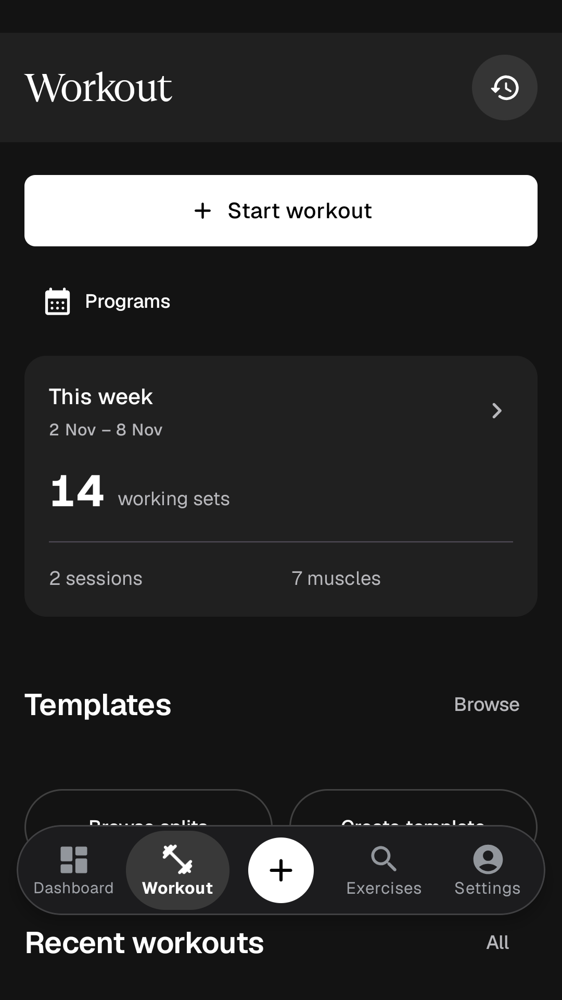

# Geist typography and native evidence

## Design decisions

The app bundles the unmodified official Geist Sans variable font and neutral Geist Serif Regular from [Vercel Geist v1.9.0](https://github.com/vercel/geist-font/releases/tag/v1.9.0). The SIL Open Font License and a pinned source/hash receipt ship in the APK. Fonts resolve offline through Android resources; there is no download, new preference, or proprietary font dependency.

The requested `emilkowalski/skill` design-engineering skill was installed and consulted. Its principles were adapted to native Compose: coherent defaults, restrained display typography, fast repeated actions, and attention to enlarged text. This is not an endorsement or review by Emil Kowalski.

| Before | After | Why |
| --- | --- | --- |
| DM Sans custom asset/typeface loader; several Material roles inherited platform defaults | All 15 Material roles explicitly use bundled Geist families | A single, cached and predictable typographic system |
| Bold Sans page headings | Regular Geist Serif for display/page headings | A quiet distinction between orientation and task controls |
| One display treatment could spill into functional metrics | Geist Sans for logger values, controls, body and headline roles; tabular body-large figures | Keep frequent numeric scanning and input practical |
| Sans-derived display leading | Serif-specific leading, full-width Settings title and no synthetic Serif bold/italics | Preserve real glyph extents and avoid artificial styles |
| Typography checked mainly at the default scale | Mounted logging and Settings checks at 100%, 135% and 200% on API 26 and 35 | Validate real layout and durable input, not just font declarations |

Existing palettes, control geometry and motion policy are preserved. No decorative animation was added to repeated workout actions.

## Native captures

These are emulator screenshots from source-mode builds, captured on 2026-11-02/03 using synthetic training fixtures. They contain no personal health data, progress photos, or operator-supplied reference media. Before/after captures are typography evidence, not a pixel-diff or a performance comparison; date-dependent calendar totals may differ.

| Before: DM Sans | After: Geist pairing |
| --- | --- |
|  |  |
|  |  |

### Enlarged text

- [Android 15 logger at 200% font scale](typography-evidence/api35-200-percent-logger.png): the long workout title ellipsizes, the exercise name wraps, and the numeric fields remain operable.
- [Android 8 Settings at 200% font scale](typography-evidence/api26-200-percent-settings.png): the Serif heading remains complete; content is scrollable rather than forced into the initial viewport.

## Verification and limits

- `TypographyContractTest` checks owned families/weights, all 15 roles, Serif leading/synthesis and tabular figures.
- `GeistTypographyJourneyTest` passed on API 26 and API 35 at 100%, 135% and 200%. It mounts MainActivity, edits an actual set through the keypad, checks durable storage, and asserts that the Settings title has no text-layout overflow.
- `PaletteShotsTest#everyPaletteInDarkAndLight` passed on API 35 and captured all five palettes in dark and light themes.
- `verify_font_assets.py` pins both font binaries, license and provenance. Regression tests cover corruption, missing assets, resource-size bounds and optimized APK resource-path shortening. Debug and R8-optimized unsigned release APKs passed public/source-mode content and font verification.

These checks do not establish physical-device performance, TalkBack usability, every locale, tablet layouts, or Health Connect provider permissions. Architecture and product-lifecycle evidence are recorded separately in [ARCHITECTURE.md](ARCHITECTURE.md). No release signing key was used.
